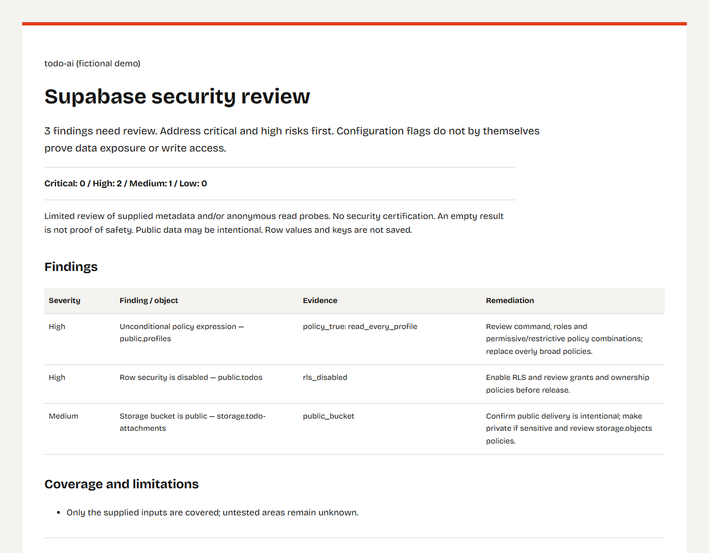

# supabase-rls-check

Consent-gated, read-only configuration and anonymous-exposure checks for Supabase projects (PostgreSQL 15+, Python 3.11+). No database password or `service_role` key required.

## Why this exists

Supabase applications intentionally ship a public `anon` JWT or `sb_publishable_` key inside browser JavaScript bundles so client code can talk directly to PostgREST (`/rest/v1/`) and Storage. Because every visitor can read that key from DevTools, access control depends directly on PostgreSQL Row Level Security (RLS), policy expressions, table/function grants, view options, and Storage bucket visibility—along with never bundling a `service_role` token in frontend code.

During rapid prototyping, AI-assisted schema generation, or manual migrations, it is easy to leave a table in `public` without RLS, keep a temporary `USING (true)` policy, or forget that PostgreSQL grants `EXECUTE` to `PUBLIC` on new `SECURITY DEFINER` functions exposed at `/rest/v1/rpc/*`. `supabase-rls-check` helps project owners review those patterns safely without modifying data or saving table rows.

## Installation

Requires Python 3.11 or newer.

Not on PyPI yet. Install from the GitHub release tag:

```bash
pipx install "git+https://github.com/Tthanh2k6/supabase-rls-check@v0.2.0"
```

Optional Model Context Protocol (MCP) server support (`mcp>=1.2`):

```bash
pipx install "supabase-rls-check[mcp] @ git+https://github.com/Tthanh2k6/supabase-rls-check@v0.2.0"
```

From source for development:

```bash
pip install -e ".[dev]"
```

## Three-step usage

### 1. Export catalog metadata with `check.sql`

Print the bundled read-only SQL query (or open [`src/supabase_rls_check/sql/check.sql`](src/supabase_rls_check/sql/check.sql)):

```bash
supabase-rls-check sql --print-sql > check.sql
```

Paste `check.sql` into the **Supabase SQL Editor**, adjust the sensitive-table name pattern if needed, run the `SELECT`, and export the single result set as CSV or JSON (`rule,schema_name,object_name,policy_name`). Only catalog metadata is queried—never application rows.

Validate and normalize the export:

```bash
supabase-rls-check sql --from export.csv --out sql_results.json --i-own-this-project
```

### 2. Optionally verify anonymous read exposure (`probe`)

Check what an unauthenticated caller can actually read with your public `anon` JWT or `sb_publishable_` key, and optionally inspect your frontend origin for leaked `service_role` JWTs:

```bash
supabase-rls-check probe \
  --url https://YOUR_PROJECT.supabase.co \
  --anon-key YOUR_ANON_OR_PUBLISHABLE_KEY \
  --site https://your-app.example \
  --out probe_results.json \
  --i-own-this-project
```

- Pass the project HTTPS origin to `--url` (not `/rest/v1/`).
- Only `anon` JWTs and `sb_publishable_` keys are accepted; `service_role` and `authenticated` tokens are rejected before any request is sent.
- If OpenAPI schema discovery is disabled on PostgREST, pass known table/view names explicitly with `--tables todos profiles`.

### 3. Generate the standalone report and dry-run SQL template

```bash
supabase-rls-check report \
  --from sql_results.json probe_results.json \
  --out-dir review_out \
  --project "My Supabase App" \
  --i-own-this-project
```

This writes three files to `review_out/`:

- `report.html` — standalone, offline-ready HTML report (A4 landscape print stylesheet for **Print -> Save as PDF**)
- `report.md` — Markdown summary suitable for issues or pull requests
- `fix.sql` — commented review template wrapped in `BEGIN; ... ROLLBACK;` (never executed by this tool; replace `user_id` with your real ownership column and test on staging first)

Add `--lang vi` to generate Vietnamese report text.

### Explaining a rule and optional MCP mode

Inspect the rationale, caveats, and remediation example for any rule without touching a target project:

```bash
supabase-rls-check explain rls_disabled
supabase-rls-check explain definer_anon_exec
```

If installed with `supabase-rls-check[mcp]`, start the local stdio MCP server:

```bash
supabase-rls-check mcp
```

The MCP server exposes only two local, read-only tools: `analyze_sql_export(path)` and `explain_rule(rule)`. Network probing is intentionally excluded from MCP so AI clients never handle API keys or send HTTP requests through this tool.

## Sample report and offline demo



Try the offline fictional dataset ([`demo/todo_ai.csv`](demo/todo_ai.csv) -> [`demo/report.md`](demo/report.md) and [`demo/fix.sql`](demo/fix.sql)):

```bash
supabase-rls-check report --from demo/todo_ai.csv --out-dir demo --project "todo-ai (fictional demo)" --i-own-this-project
supabase-rls-check report --from demo/todo_ai.csv --out-dir demo/vi --project "todo-ai (dữ liệu giả)" --lang vi --i-own-this-project
```

## Eleven checks: SQL catalog rules

`check.sql` inspects PostgreSQL 15+ system catalogs and `storage.buckets` in a single read-only CTE query:

| Rule ID | Severity | Meaning |
| --- | --- | --- |
| `rls_disabled` | High | Table or partitioned table in `public` has Row Level Security disabled (`relrowsecurity = false`). |
| `policy_true` | High | Policy in `public` has an unconditional `USING (true)` or `WITH CHECK (true)` expression. |
| `sensitive_anon_policy` | High | Policy granted to `anon` or `public` on a table matching common sensitive names (`user`, `profile`, `order`, `payment`, `invoice`, `customer`, `patient`, `secret`, `token`, `document`). |
| `definer_anon_exec` | High | Non-trigger `SECURITY DEFINER` function in `public` is executable by `anon` (callable via `/rest/v1/rpc/*`). |
| `definer_search_path` | High | `SECURITY DEFINER` function in `public` has no fixed `search_path` set on the function definition. |
| `view_not_invoker` | High | View in `public` does not enable `security_invoker`, so base-table queries run with view-owner privileges. |
| `public_bucket` | Medium | Supabase Storage bucket in `storage.buckets` is marked `public = true`. |
| `public_extension` | Low | PostgreSQL extension is installed directly in `public` rather than a dedicated `extensions` schema. |
| `policy_user_metadata` | High | Policy in `public` reads user-editable `user_metadata` from `auth.jwt()` or `request.jwt.claims`. Use server-managed `app_metadata` or a protected authorization table. |
| `policy_auth_per_row` | Low | Policy on an RLS-enabled table in `public` calls `auth.uid()`, `auth.jwt()`, `auth.role()`, or `current_setting()` without a sub-select. Performance finding: use `(select auth.uid())` for row-independent calls. |
| `auth_users_exposed` | Critical | Public view directly depends on `auth.users`, allows `anon` or `authenticated` to SELECT, and is materialized or lacks `security_invoker`. Drop it or harden a regular view and revoke access; publish only needed profile columns from a separate table. |

The three new rules add only commented guidance to `fix.sql`; they never generate automatic DDL. Policy expression checks are heuristics over PostgreSQL's deparsed SQL. The authentication performance check recognizes directly SELECT-wrapped calls; complex subqueries need manual review. The Auth exposure check follows direct dependencies and returns no findings when `auth.users` is absent.

### Additional checks from `probe`

When `probe` is run, two runtime checks complement the SQL catalog export:

- `anon_readable` (**High**) — PostgREST returned visible rows for an unauthenticated `GET`/`HEAD` request using the `anon` or publishable key (records column names and visible row count only).
- `service_role_exposed` (**Critical**) — A JWT whose payload decodes to `role = "service_role"` was found in frontend HTML or a directly linked same-origin script.

Tip: pass the anon key through the `SUPABASE_ANON_KEY` environment variable instead of `--anon-key` to keep it out of shell history.

## How it is tested

- **66 unit tests** (`pytest`): consent flag enforcement, GET/HEAD-only probing with no redirects, response size limits, row values and keys never written to disk, `service_role` JWT detection, HTML/SQL escaping in reports, identifier quoting in `fix.sql`, English and Vietnamese output, all 11 catalog rules in reports/explanations, comment-only fixes for the new rules, and the MCP tool surface (no `probe` exposed).
- **Catalog query on a real PostgreSQL 15** (GitHub Actions): `tests/fixtures/seed_pg.sql` plants issues for all 11 rules next to safe controls. CI compares all 19 expected findings exactly, including overlapping view findings, and rejects extra or missing rows. Cases cover both JWT sources, all four authentication helpers, mixed wrapped/unwrapped calls, materialized views, role grants, and safe `app_metadata`/sub-select/invoker controls. The query runs with read-only transactions, including separate cases without an `auth` schema or `auth.users` table.
- **Abuse cases checked by hand**: running any command without `--i-own-this-project` exits before touching the network; passing a `service_role` key to `probe` is refused; the MCP server cannot reach the network.

## Ethical boundaries

- **Authorization required**: Only scan projects you own or have explicit **written authorization** to test, including any `--site` frontend domain. Commands that process project exports or targets require `--i-own-this-project` or `--have-written-consent`.
- **Strictly read-only**: `probe` sends `GET` and `HEAD` requests only—never `POST`, `PUT`, `PATCH`, `DELETE`, or RPC invocations. HTTP redirects are not followed, `trust_env` is disabled, responses are capped at 5 MB, and timeouts are fixed at 20 seconds.
- **No customer row storage**: `probe` requests at most `limit=1` row per relation in memory, extracts column names, discards row values immediately, and strips JWT patterns (`[REDACTED]`) from metadata and error messages.

## Limitations (not a penetration test)

This tool is a configuration and anonymous-read review aid, **not a penetration test** and **not a security certification**:

- Configuration findings are review signals, not proof of exploitability; public buckets or anonymous `SELECT` policies are sometimes intentional.
- An empty finding list, HTTP `200 []`, or `401`/`403` on a single request does not prove overall safety.
- Does **not** test authenticated cross-user / multi-tenant isolation, `INSERT`/`UPDATE`/`DELETE` permissions, SQL function bodies, Edge Functions, custom Auth hooks, or complex `storage.objects` policy combinations.
- `--site` inspects only the entry HTML document and up to 20 directly linked same-origin HTTPS `<script src>` files. Dynamically imported chunks, source maps, split/obfuscated tokens, and non-JWT secret formats (`sb_secret_*`) are outside its coverage, and JWT signatures are not verified.
- `fix.sql` is a starting template ending in `ROLLBACK;`. Adding a new permissive policy does not override existing broad permissive policies—always export existing policies/grants and test two-user isolation on staging before committing changes.

## Use it from an AI coding agent

- **Agent skill** (Claude Code, Cursor, Codex and other SKILL.md agents): [Supabase RLS Review on Agensi](https://www.agensi.io/skills/supabase-rls-review) walks the agent through the review, policy fixes and a two-user isolation test on staging.
- **MCP server listing**: [supabase-rls-check on Glama](https://glama.ai/mcp/servers/Tthanh2k6/supabase-rls-check).

## Need a human review?

Need a manual review of RLS policies, `SECURITY DEFINER` function bodies, and two-user staging isolation? Book a fixed-scope review here: https://contra.com/s/sFUXWqOZ-supabase-security-check-for-lovable-bolt-and-v0-apps

## License

Code is released under the [MIT License](LICENSE) (Copyright (c) 2026 Trung Thanh Tran). Bundled Bricolage Grotesque report fonts in `assets/` are licensed under the SIL Open Font License 1.1 ([`assets/BricolageGrotesque-OFL.txt`](assets/BricolageGrotesque-OFL.txt)).
