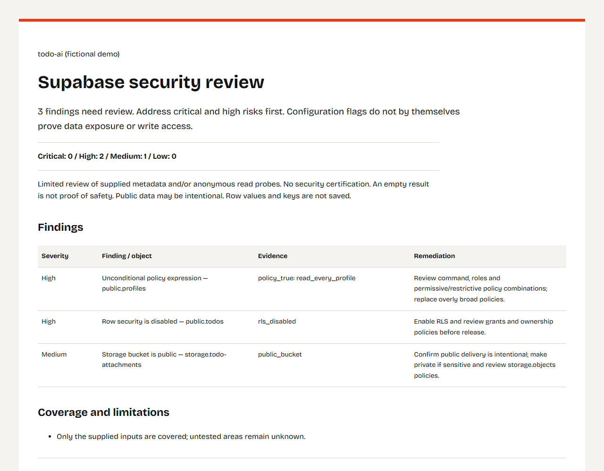

# supabase-rls-check

<!-- mcp-name: io.github.Tthanh2k6/supabase-rls-check -->

[](https://pypi.org/project/supabase-rls-check/)

A command-line tool that reads PostgreSQL catalog metadata from a Supabase project and flags Row Level Security (RLS) mistakes: tables without RLS, `USING (true)` policies, `SECURITY DEFINER` functions callable by `anon`, public Storage buckets and 13 other patterns. It also scans a local app folder for leaked `service_role` keys. It never needs a database password or a `service_role` key, and it never reads table rows. It also ships as an MCP server and a GitHub Action. Python 3.11+, PostgreSQL 15+.

It is for people who ship a Supabase app with the `anon` key in the browser and want to check what that key can reach. It is a review aid, not a penetration test (see Limitations).

```bash
pipx install supabase-rls-check      # or: uvx supabase-rls-check --help
supabase-rls-check report --from demo/todo_ai.csv --out-dir demo --project "todo-ai (fictional demo)" --i-own-this-project
```

The second command runs on the fictional dataset in [`demo/todo_ai.csv`](demo/todo_ai.csv):

```
rule,schema_name,object_name,policy_name
rls_disabled,public,todos,
policy_true,public,profiles,read_every_profile
public_bucket,storage,todo-attachments,
```

It writes [`demo/report.md`](demo/report.md), `demo/report.html` and [`demo/fix.sql`](demo/fix.sql). The Markdown report contains this table:

| Severity | Finding / object | Evidence |
| --- | --- | --- |
| High | Unconditional policy expression: public.profiles | policy_true: read_every_profile |
| High | Row security is disabled: public.todos | rls_disabled |
| Medium | Storage bucket is public: storage.todo-attachments | public_bucket |

`fix.sql` is a review template that starts with `BEGIN;` and ends with `ROLLBACK;`. It enables RLS on `profiles` and `todos` and leaves a commented example policy for you to adapt.



## Install

```bash
pipx install supabase-rls-check
pipx install "supabase-rls-check[mcp]"   # adds the MCP server (mcp>=1.10)
pip install -e ".[dev]"                  # from a source checkout
```

## Usage

### 1. Export catalog metadata with `check.sql`

```bash
supabase-rls-check sql --print-sql > check.sql
```

Paste `check.sql` into the Supabase SQL Editor, adjust the sensitive-table name pattern if needed, run it, and export the single result set as CSV or JSON (columns `rule,schema_name,object_name,policy_name,basis`). The query reads catalogs only, never application rows. The query file is also at [`src/supabase_rls_check/sql/check.sql`](src/supabase_rls_check/sql/check.sql).

Validate and normalize the export:

```bash
supabase-rls-check sql --from export.csv --out sql_results.json --i-own-this-project
```

### 2. Optional: check anonymous read access with `probe`

`probe` asks your project, with the public key only, which tables an unauthenticated visitor can read. With `--site` it also looks for a `service_role` JWT in your frontend.

```bash
supabase-rls-check probe \
  --url https://YOUR_PROJECT.supabase.co \
  --anon-key YOUR_ANON_OR_PUBLISHABLE_KEY \
  --site https://your-app.example \
  --out probe_results.json \
  --i-own-this-project
```

- Pass the project origin to `--url`, not `/rest/v1/`.
- Only `anon` JWTs and `sb_publishable_` keys are accepted. `service_role` and `authenticated` tokens are rejected before any request is sent.
- If OpenAPI discovery is off on PostgREST, name the tables yourself with `--tables todos profiles`.
- Set `SUPABASE_ANON_KEY` instead of `--anon-key` to keep the key out of shell history.

It adds two findings: `anon_readable` (High; column names and visible row count only) and `service_role_exposed` (Critical; a JWT with `role = "service_role"` found in the page HTML or a same-origin script).

### 3. Build the report

```bash
supabase-rls-check report \
  --from sql_results.json probe_results.json \
  --out-dir review_out \
  --project "My Supabase App" \
  --i-own-this-project
```

Output in `review_out/`:

- `report.html`: standalone, works offline, A4 landscape print stylesheet for Save as PDF.
- `report.md`: summary for issues or pull requests.
- `fix.sql`: commented review template wrapped in `BEGIN; ... ROLLBACK;`. The tool never runs it. Replace `user_id` with your ownership column and test on staging first.

Add `--lang vi` for Vietnamese text. A Vietnamese demo is in [`demo/vi/report.md`](demo/vi/report.md).

### Scan your app folder for leaked secrets

`scan-env` reads local files only, needs no network and no consent flag, and masks every secret it prints (first 6 characters, then `…`, then last 4).

```bash
supabase-rls-check scan-env . --out envscan.json
supabase-rls-check report --from sql_results.json envscan.json --out-dir review_out --project "My Supabase App" --i-own-this-project
```

It reads `.env`, `.env.*`, `app.json`, `app.config.*`, `eas.json`, AI agent and MCP config files (`.claude/settings.json`, `.claude/settings.local.json`, `.cursor/mcp.json`, `.mcp.json`, `.vscode/mcp.json`) and client source files (`*.js`, `*.jsx`, `*.ts`, `*.tsx`, `*.mjs`, `*.cjs`, `*.vue`, `*.svelte`). It skips `node_modules`, `.git`, virtualenvs, build output (`dist`, `build`, `web-build`, `android/app/build`, `ios/build`, `ios/Pods`), binary files and files over 2 MB.

It reports:

- `public_env_service_role` (Critical) and `public_env_secret_key` (High): secrets in variables that get bundled into the client (`EXPO_PUBLIC_`, `NEXT_PUBLIC_`, `VITE_`, `REACT_APP_`, `PUBLIC_`, `NUXT_PUBLIC_`).
- `service_role_in_client_code` and `db_url_in_client_code` (both Critical): `service_role` JWTs, `sb_secret_` keys or Postgres URLs with a password in client files. `supabase/functions/`, `server/`, `api/`, `scripts/` and `backend/` are excluded.
- `agent_config_secret` (Critical): the same secrets in agent or MCP config files, reported with the file path and, for valid JSON, the key path.

The `anon` JWT and `sb_publishable_` keys belong in a client app and are never reported. Matching is line by line, so obfuscated, split or encoded keys can be missed.

### Explain a rule, run the MCP server

```bash
supabase-rls-check explain rls_disabled
supabase-rls-check explain definer_anon_exec
supabase-rls-check mcp        # needs the [mcp] extra; stdio transport
```

The MCP server has four local, read-only tools: `analyze_sql_export(path)`, `explain_rule(rule)`, `scan_public_env(path)` and `diff_results(old_path, new_path)`. `probe` is not exposed, so an AI client never handles your API key or makes HTTP requests through this tool.

### Compare two runs with `diff`

```bash
supabase-rls-check diff \
  --old baseline_results.json \
  --new sql_results.json \
  --out diff.json \
  --fail-on-new high
```

`diff` lists findings that are new or resolved between two local CSV or JSON files. With `--fail-on-new` (`critical`, `high`, `medium` or `low`) it exits `1` when a new finding at or above that severity appears. A finding is keyed by `(rule, schema_name, object_name, policy_name, basis)`. `basis` says why a heuristic rule fired, for example `table name matches pattern 'payment'` or `table comment tag 'pii'`. Adding a `pii` comment to a table therefore shows up as a new finding, and the earlier pattern-based one as resolved. JSON files without a `basis` key still load, with `basis` set to `""`.

One consequence: a baseline exported before 0.6.1 lists an extension-owned table with an empty `basis`. The first diff against it reports that table as new (with `owned by extension <name>`) and the old entry as resolved, so `--fail-on-new high` exits `1` once. Export the baseline again with 0.6.1 or later to clear it.

## GitHub Action

The repository is a composite action. It runs `check.sql` with `psql` inside a `default_transaction_read_only` session, writes `report.md`, `report.html` and `fix.sql`, adds a summary table to the job page, and fails the job when a finding is at or above `fail-on`. Unlike the flow above, it needs a Postgres connection string. Store it as a repository secret and point it at staging or a read-only role. The action refuses to run unless `i-own-this-project` is `"true"`. Outputs: `findings` (total) and `failing` (at or above `fail-on`).

```yaml
name: RLS check
on: [pull_request]
jobs:
  rls:
    runs-on: ubuntu-latest
    steps:
      - uses: Tthanh2k6/supabase-rls-check@main
        with:
          database-url: ${{ secrets.STAGING_DATABASE_URL }}
          i-own-this-project: "true"
          fail-on: High        # Critical, High, Medium, Low or none
      - uses: actions/upload-artifact@v4
        if: always()
        with:
          name: rls-report
          path: rls-report/
```

To catch schema drift outside pull requests, run `check.sql` on a schedule and diff it against a baseline, for example `.rls-baseline.json` committed to the repository:

```yaml
name: RLS drift check
on:
  pull_request:
  schedule:
    - cron: "0 6 * * *"
jobs:
  drift:
    runs-on: ubuntu-latest
    steps:
      - uses: actions/checkout@v4
      - uses: actions/setup-python@v5
        with:
          python-version: "3.12"
      - name: Run check.sql and diff against baseline
        env:
          DATABASE_URL: ${{ secrets.STAGING_DATABASE_URL }}
        run: |
          python -m pip install supabase-rls-check
          supabase-rls-check sql --print-sql > check.sql
          PGOPTIONS='-c default_transaction_read_only=on' \
            psql "$DATABASE_URL" -v ON_ERROR_STOP=1 --csv -f check.sql > current.csv
          supabase-rls-check sql --from current.csv --out current.json --i-own-this-project
          supabase-rls-check diff \
            --old .rls-baseline.json \
            --new current.json \
            --out diff.json \
            --fail-on-new high
      - uses: actions/upload-artifact@v4
        if: always()
        with:
          name: rls-diff
          path: |
            current.json
            diff.json
```

## Rules

`check.sql` has 17 rules. It queries PostgreSQL 15+ system catalogs and `storage.buckets` in one read-only query. The table also lists two `scan-env` rules that read local files.

| Rule ID | Severity | What it flags |
| --- | --- | --- |
| `rls_disabled` | High | Table or partitioned table in `public` with RLS off. If an extension owns the table (for example PostGIS `spatial_ref_sys`), it is still reported with `basis` = `owned by extension <name>`, and `fix.sql` suggests moving the extension to an `extensions` schema, because `ENABLE ROW LEVEL SECURITY` fails there with "must be owner" (see [supabase/supabase discussion #52767](https://github.com/supabase/supabase/discussions/52767)). Detection uses `pg_depend` (`deptype = 'e'`) and covers direct extension members only. Some extensions cannot be relocated, so check first. |
| `policy_true` | High | Policy in `public` with `USING (true)` or `WITH CHECK (true)`. |
| `policy_true_writable` | Critical | Permissive `UPDATE`, `DELETE` or `ALL` policy for `anon`, `authenticated` or `public` with `USING (true)`, on a table where `anon` or `authenticated` holds `UPDATE` or `DELETE`. Anyone with that role can change or delete every row. |
| `sensitive_anon_policy` | High | Policy granted to `anon` or `public` on a table whose name matches `user`, `profile`, `order`, `payment`, `invoice`, `customer`, `patient`, `secret`, `token` or `document`, or that has a `pii` table comment. `basis` records which one matched. |
| `definer_anon_exec` | High | Non-trigger `SECURITY DEFINER` function in `public` that `anon` can execute (callable at `/rest/v1/rpc/*`). |
| `definer_search_path` | High | `SECURITY DEFINER` function in `public` with no fixed `search_path`. |
| `view_not_invoker` | High | View in `public` without `security_invoker`, so it runs with the owner's privileges. |
| `public_bucket` | Medium | Storage bucket with `public = true`. |
| `public_bucket_listable` | Medium | Public bucket that also has an `anon` or `public` `SELECT` (or `ALL`) policy on `storage.objects` matching the bucket id or `true`, so anyone can list its file names. |
| `public_extension` | Low | Extension installed in `public` instead of an `extensions` schema. |
| `policy_user_metadata` | High | Policy in `public` that reads user-editable `user_metadata` from `auth.jwt()` or `request.jwt.claims`. Use `app_metadata` or an authorization table. |
| `policy_auth_per_row` | Low | Policy on an RLS-enabled table that calls `auth.uid()`, `auth.jwt()`, `auth.role()` or `current_setting()` without a sub-select. This is a performance finding: write `(select auth.uid())`. |
| `auth_users_exposed` | Critical | View in `public` that depends directly on `auth.users`, lets `anon` or `authenticated` `SELECT`, and is materialized or lacks `security_invoker`. |
| `matview_api_exposed` | High | Materialized view or foreign table in `public` that `anon` or `authenticated` can `SELECT`. RLS does not apply to materialized views, so every row is readable through the Data API. |
| `policy_any_authenticated` | Medium | Policy that only checks the caller is signed in (`auth.role() = 'authenticated'` or `auth.uid() IS NOT NULL`), so every account gets the same access. |
| `secret_column_exposed` | Medium | Column in `public` named or ending in `api_key`, `apikey`, `secret`, `client_secret`, `access_token`, `refresh_token`, `private_key` or `password` that `anon` or `authenticated` can `SELECT` (`basis` = column name). RLS limits rows, but the client still receives the plaintext value. |
| `definer_trusts_id_arg` | Medium | `SECURITY DEFINER` function in `public`, executable by `anon` or `authenticated`, with an argument ending in `_id` or equal to `uid`, `user`, `org` or `tenant`, whose source never references `auth.uid()` or `auth.jwt()` (`basis` = argument names). Needs review: it misses functions that delegate the check to a helper and may flag ones that validate the ID against a membership table. |
| `db_url_in_client_code` | Critical | `scan-env`: a `postgres(ql)://user:password@` URL in a client-bundled file. Placeholders such as `${DB_PASSWORD}` are ignored. |
| `agent_config_secret` | Critical | `scan-env`: an `sb_secret_` key, `service_role` JWT or Postgres URL with a password in an agent or MCP config file. |

`policy_true_writable`, `policy_user_metadata`, `policy_auth_per_row`, `auth_users_exposed`, `matview_api_exposed`, `public_bucket_listable`, `policy_any_authenticated`, `secret_column_exposed` and `definer_trusts_id_arg` add only commented guidance to `fix.sql`, never DDL. To make `sensitive_anon_policy` independent of table names, tag tables with `COMMENT ON TABLE public.x IS 'pii'`.

Some rules overlap on purpose. `policy_true` fires on the same policy as `policy_true_writable`. A materialized view over `auth.users` produces both `auth_users_exposed` and `matview_api_exposed`. A regular view over `auth.users` can also trigger `view_not_invoker`. A listable public bucket produces both `public_bucket` and `public_bucket_listable`.

Policy checks are heuristics over PostgreSQL's deparsed SQL. The per-row auth check only recognizes calls wrapped directly in a `SELECT`; complex subqueries need manual review. The `auth.users` check follows direct dependencies and returns nothing when `auth.users` does not exist.

## How it is tested

- `pytest` runs 133 tests offline (`python -m pytest -q`; an autouse fixture blocks real network requests). They cover consent-flag enforcement, GET/HEAD-only probing without redirects, response size limits, row values and keys never written to disk, `service_role` JWT detection, `scan-env` (agent/MCP config, React Native and Expo files, masked output), `diff` including `basis` changes and severity gating, HTML and SQL escaping, identifier quoting in `fix.sql`, English and Vietnamese output, all 17 catalog rules, and the MCP tool list (no `probe`).
- GitHub Actions runs `check.sql` on a real PostgreSQL 15. `tests/fixtures/seed_pg.sql` plants issues for all 17 rules next to safe controls, and CI compares the 32 expected findings (with `basis`) exactly, failing on any extra or missing row. The fixture includes both JWT sources, extension-owned tables, column-level `REVOKE`s and `pii` comments, and CI also runs the query without an `auth` schema or `auth.users` table.
- A second CI job, `diff-e2e` (also runnable as `scripts/e2e_diff.py` with `psql` available), applies a small schema, builds a report, reruns unchanged (`diff --fail-on-new high` exits `0`), adds `COMMENT ON TABLE ... IS 'pii'`, reruns, and checks that the same command now exits non-zero on `sensitive_anon_policy`.

## Safety rules

- Use it only on projects you own or have written permission to test, including any `--site` domain. Commands that process project exports or targets need `--i-own-this-project` or `--have-written-consent`, and exit before touching the network without one.
- `probe` sends `GET` and `HEAD` only. It does not follow redirects, sets `trust_env` to false, caps responses at 5 MB and uses a 20 second timeout.
- `probe` asks for at most `limit=1` row per relation, keeps it in memory, extracts column names, discards the values and replaces JWT patterns with `[REDACTED]` in metadata and error messages.

## Limitations

This is a configuration and anonymous-read review aid. It is not a penetration test or a security certification.

- Findings are review signals. A public bucket or an anonymous `SELECT` policy is sometimes intended.
- An empty result, an HTTP `200 []` or a `401`/`403` on one request does not show the project is safe.
- It does not test cross-user isolation between authenticated users, `INSERT`/`UPDATE`/`DELETE` permissions, function bodies, Edge Functions, custom Auth hooks or complex `storage.objects` policy combinations.
- `--site` reads the entry HTML and up to 20 directly linked same-origin HTTPS `<script src>` files. Dynamically imported chunks, source maps, split or obfuscated tokens and `sb_secret_*` keys are outside its reach, and JWT signatures are not verified.
- `fix.sql` is a starting template ending in `ROLLBACK;`. A new permissive policy does not override existing broad ones. Export the current policies and grants, and test with two users on staging before committing changes.

## Related

- Agent skill for Claude Code, Cursor, Codex and other SKILL.md agents: [Supabase RLS Review on Agensi](https://www.agensi.io/skills/supabase-rls-review). It walks the agent through the review, policy fixes and a two-user isolation test on staging.
- MCP listings: [Glama](https://glama.ai/mcp/servers/Tthanh2k6/supabase-rls-check) and [mcprush](https://mcprush.com/to/supabase-rls-check-mcp?ref=badge).
- Paid manual review of RLS policies, `SECURITY DEFINER` bodies and two-user isolation on staging, from $69 (report plus a ROLLBACK-wrapped fix script): [Upwork](https://www.upwork.com/services/product/2119987807643160130), [Contra](https://contra.com/s/sFUXWqOZ-supabase-security-check-for-lovable-bolt-and-v0-apps).

## License

Code: [MIT License](LICENSE), Copyright (c) 2026 Trung Thanh Tran. The Bricolage Grotesque report fonts in `assets/` are under the SIL Open Font License 1.1 ([`assets/BricolageGrotesque-OFL.txt`](assets/BricolageGrotesque-OFL.txt)).
